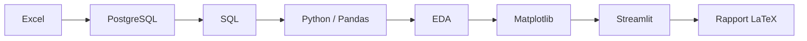
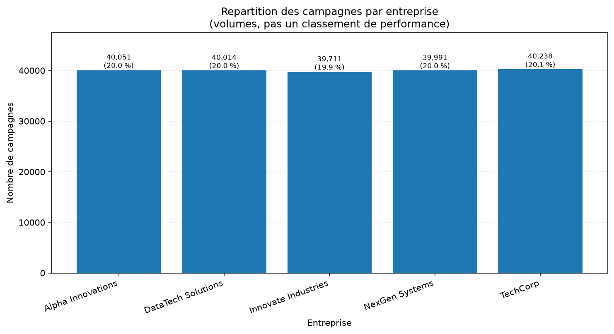
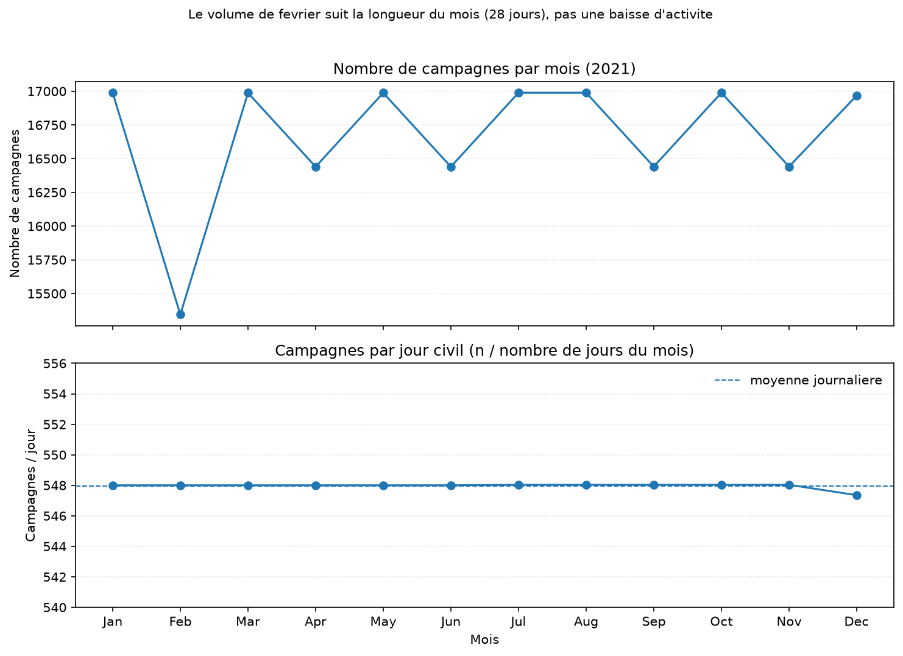
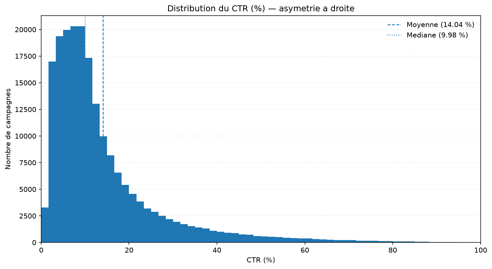
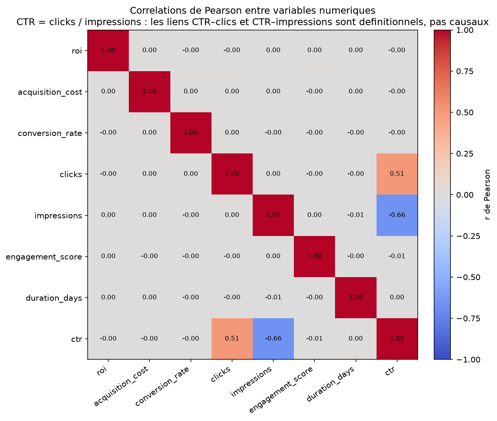
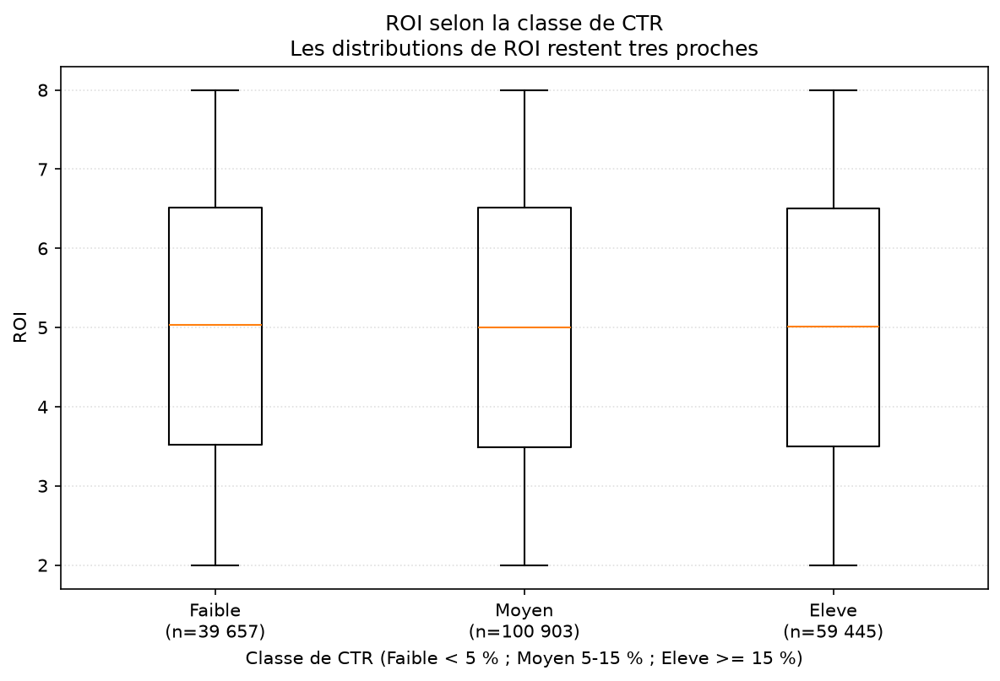

# Analyse des performances des campagnes marketing

## Summary (English)

Personal end-to-end data analysis project on a dataset of **200,005 marketing campaigns** dated 2021 (5 companies, 5 campaign types, 6 channels).

- **Pipeline:** Excel → PostgreSQL → SQL → Python/Pandas → EDA → Matplotlib → Streamlit → LaTeX report.
- **SQL:** exploratory, SELECT-only queries (aggregations, `CASE`, monthly volumes) in [`sql/analyses.sql`](sql/analyses.sql).
- **Python:** data extraction, preparation, quality checks and EDA with Pandas; 16 Matplotlib charts in [`visualisations/`](visualisations/).
- **Dashboard:** local Streamlit app ([`dashboard/dashboard.py`](dashboard/dashboard.py)) with 6 KPIs, 8 combinable filters, a correlation heatmap and CSV export of the filtered data. It reads PostgreSQL with SELECT-only queries and needs a local, populated database to run.
- **Report:** 40-page analysis report in French ([`rapport_analyse_marketing.pdf`](rapport_analyse_marketing.pdf)), covering findings and limitations.

Key findings are descriptive: campaign volumes are evenly balanced across categories, the average ROI stays close to 5 across all dimensions, and the strongest correlations are mechanical (CTR = clicks / impressions). No causal claims or business recommendations are drawn from these small differences.

The source dataset is not included in this repository (see [`data/README.md`](data/README.md)). The rest of this README is in French.

---

Projet Data Analytics de bout en bout portant sur l'analyse de **200 005 campagnes marketing** sur l'année **2021**.

Chaîne complète :

```text
Excel → PostgreSQL → SQL → Python/Pandas → EDA → Matplotlib → Streamlit → Rapport LaTeX
```



## Objectifs

- mesurer les KPI marketing ;
- comparer les performances selon différentes dimensions ;
- explorer les relations entre variables ;
- analyser l'évolution temporelle ;
- produire des visualisations ;
- construire un dashboard interactif ;
- documenter les résultats.

## Dataset

Caractéristiques validées :

| Élément | Valeur |
|---|---|
| Campagnes | 200 005 |
| Période | 2021-01-01 → 2021-12-31 |
| Variables originales | 15 |
| Variables après préparation Pandas | 21 |
| Entreprises | 5 |
| Types de campagnes | 5 |
| Canaux | 6 |
| Audiences | 5 |
| Segments | 5 |
| Localisations | 5 |

Le fichier Excel **n'est pas publié** dans ce dépôt (taille, absence de licence publique). Voir [`data/README.md`](data/README.md).

Les scripts lisent PostgreSQL (`marketing_analysis.public.marketing_campaigns`), pas le fichier Excel.

## Technologies

- PostgreSQL 18.6
- SQL
- Python
- Pandas
- NumPy
- SQLAlchemy
- psycopg2
- Matplotlib
- Streamlit
- LaTeX
- MiKTeX

## Pipeline

1. Import Excel
2. Stockage PostgreSQL
3. Contrôles qualité
4. Analyse SQL
5. Extraction vers Python
6. Préparation Pandas
7. EDA
8. Visualisations
9. Dashboard
10. Rapport final

## Architecture

Le projet utilise volontairement une table relationnelle principale `marketing_campaigns`.

Une modélisation en étoile ou en flocon n'a pas été retenue, car elle n'était pas nécessaire pour le périmètre analytique de ce projet.

Grain : une ligne = une campagne. Pas de tables de faits / dimensions séparées.

## Résultats

Constats descriptifs, sans inférence causale :

- 200 005 campagnes ;
- ROI moyen ≈ 5,00 (5,0024) ;
- coût d'acquisition moyen ≈ 12 504 ;
- conversion moyenne ≈ 8,01 % ;
- CTR moyen ≈ 14,04 % ;
- médiane CTR ≈ 9,98 % ;
- engagement moyen ≈ 5,49 ;
- environ 548 campagnes/jour ;
- faibles écarts de ROI entre catégories ;
- corrélations CTR/clicks et CTR/impressions liées à la définition du CTR (`CTR = clics / impressions`).

Aucune recommandation d'allocation budgétaire ou de ciblage n'est déduite de ces écarts.

## Visualisations

Graphiques principaux (Matplotlib, sans Seaborn ni Plotly) :











Les 16 figures se trouvent dans [`visualisations/`](visualisations/).

## Dashboard

Application Streamlit (`dashboard/dashboard.py`) :

- filtres combinables (entreprise, type, canal, audience, segment, localisation, trimestre, mois) avec option « Tous » ;
- KPI recalculés sur le sous-ensemble filtré ;
- graphiques Matplotlib dynamiques ;
- export CSV `marketing_campaigns_filtered.csv` à partir du DataFrame filtré uniquement.

Le DataFrame source n'est jamais modifié. Le mot de passe PostgreSQL est saisi dans l'interface (champ masqué) ou via la variable d'environnement `PGPASSWORD`. Il n'est **jamais** écrit dans le code.

Aucune capture d'écran du dashboard n'est jointe (voir [`docs/README.md`](docs/README.md)).

```bash
streamlit run dashboard/dashboard.py
```

## Rapport

Rapport LaTeX final : [`rapport_analyse_marketing.pdf`](rapport_analyse_marketing.pdf)

- 40 pages ;
- 18 figures ;
- 12 tableaux ;
- bibliographie ;
- références croisées validées.

Sources : [`report/`](report/). Compilation :

```bash
cd report
python scripts/compile.py
```

## Installation

```bash
git clone https://github.com/MediJr/marketing-campaign-analysis.git
cd marketing-campaign-analysis

python -m venv .venv

# Windows
.venv\Scripts\activate

pip install -r requirements.txt
```

Prérequis hors Python :

- PostgreSQL 18, base `marketing_analysis`, rôle `data_project`, table `public.marketing_campaigns` (200 005 lignes) ;
- mot de passe du rôle, saisi au clavier (`getpass`) ou via `PGPASSWORD` — jamais dans le dépôt.

Exemple de variables (sans mot de passe) : [`.env.example`](.env.example).

### Scripts d'analyse

Depuis la racine du dépôt, après activation de l'environnement :

```bash
python src/postgres_to_python.py
python src/python_dataframe_profiling.py
python src/python_eda.py
python src/python_visualisations.py
```

Les requêtes SQL documentées sont dans [`sql/analyses.sql`](sql/analyses.sql) (lecture seule).

## Structure

```text
marketing-campaign-analysis/
├── README.md
├── requirements.txt
├── .gitignore
├── .env.example
├── rapport_analyse_marketing.pdf
├── data/
│   └── README.md
├── sql/
│   └── analyses.sql
├── src/
│   ├── postgres_to_python.py
│   ├── python_dataframe_profiling.py
│   ├── python_eda.py
│   └── python_visualisations.py
├── dashboard/
│   └── dashboard.py
├── visualisations/
│   └── *.png
├── report/
│   └── ...
└── docs/
    └── README.md
```

## Licence du rapport LaTeX

La mise en page du rapport s'appuie sur le template [sikatikenmogne/latex-report-template](https://github.com/sikatikenmogne/latex-report-template) (MIT).
